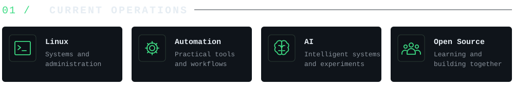
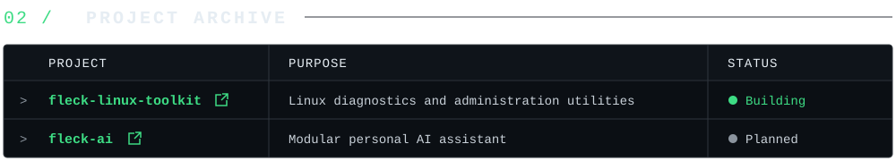
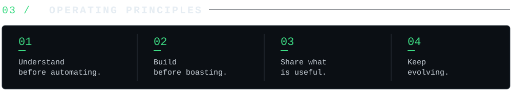

<code>&gt; open</code> &nbsp;
<a href="https://github.com/YOUR-USERNAME/fleck-linux-toolkit"><code>fleck-sentinel</code></a> &nbsp;·&nbsp;
<a href="https://github.com/YOUR-USERNAME/fleck-ai"><code>fleck-ai</code></a>

