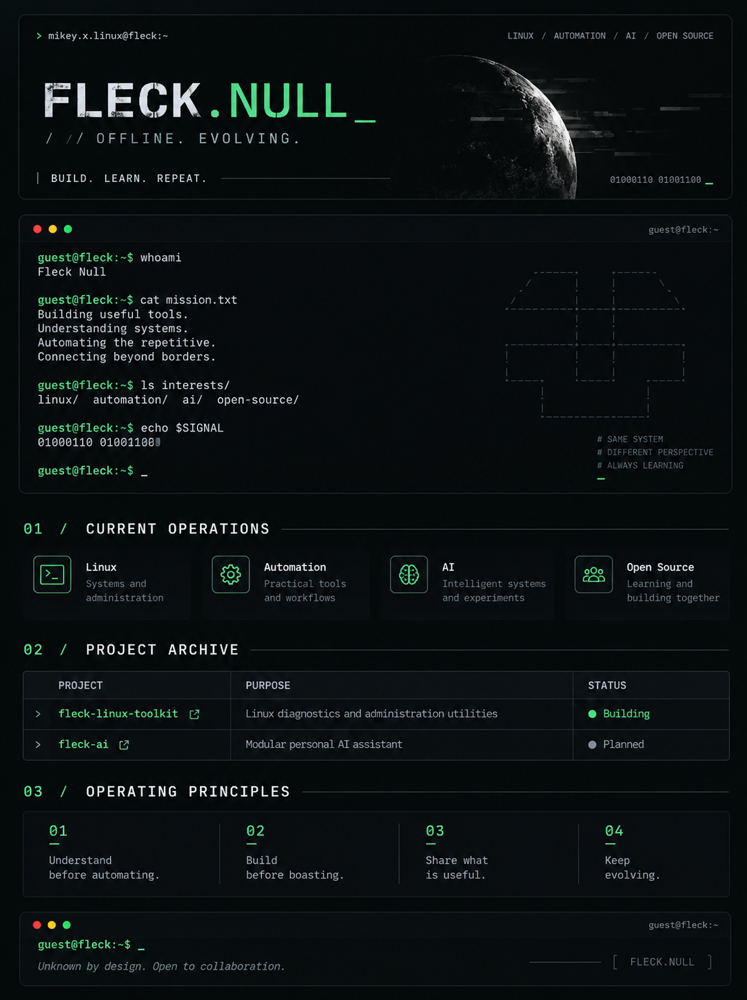

<div align="center">
  
</div>

<div align="center">

`// OFFLINE. EVOLVING.`

**BUILD. LEARN. REPEAT.**

`01000110 01001100`

</div>

---

## `01 / CURRENT OPERATIONS`

| Focus | Mission |
|:--|:--|
| `Linux` | Systems and administration |
| `Automation` | Practical tools and workflows |
| `AI` | Intelligent systems and experiments |
| `Open Source` | Learning and building together |

## `02 / PROJECT ARCHIVE`

| Project | Purpose | Status |
|:--|:--|:--|
| [`fleck-linux-toolkit`](https://github.com/flecknull/fleck-linux-toolkit) | Linux diagnostics and administration utilities | `BUILDING` |
| `fleck-ai` | Modular personal AI assistant | `PLANNED` |

> Project links and status should be updated as the repositories become available.

## `03 / OPERATING PRINCIPLES`

```text
guest@fleck:~$ cat principles.txt
[01] Understand before automating.
[02] Build before boasting.
[03] Share what is useful.
[04] Keep evolving.
```

---

<div align="center">

```text
guest@fleck:~$ _
```

*Unknown by design. Open to collaboration.*

</div>
